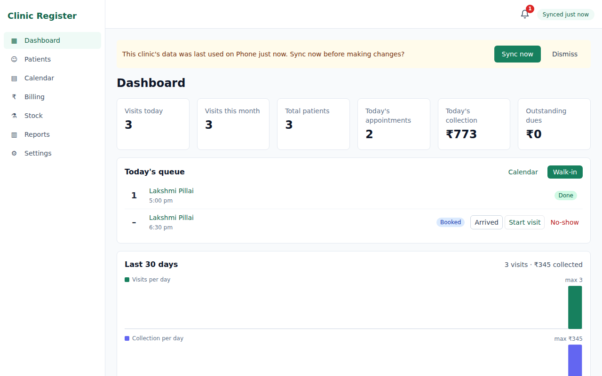

# Clinic Register

An offline-first outpatient register for homeopathy clinics. It covers patients, case notes and prescriptions, appointments, billing, stock, certificates and reports. Clinic Register is an installable Progressive Web App: all data is stored in the browser and synced to the clinic's own Google Drive, optionally encrypted with a passphrase. No server or database is needed.



## Features

- **Patients**: OP numbers (`OP-2026-00001`), search by name, phone or OP number, age from date of birth, multiple diagnoses per patient, and printable OP slips with a QR code.
- **Visits**: tabbed case notes (complaint, history, mentals, generals, modalities, constitution) and prescriptions. Remedy autocomplete, potency, dose and repetition presets, "repeat last prescription" and follow-up dates speed these up.
- **Appointments**: day, week and month calendar, with overlap checks when booking, walk-ins, and a token-based daily queue.
- **Billing**: bills from visits or counter sales, discounts, part payments, receipts, voids and reversals. The dues list shows how long each amount has been outstanding.
- **Stock**: medicines by remedy, potency and form, with purchases, adjustments, dispensing history and low-stock alerts.
- **Certificates**: numbered medicine and medical (rest) certificates with editable wording, the clinic letterhead, an optional signature and seal, and a logo watermark.
- **WhatsApp messaging**: due-payment reminders and custom message templates (greetings, follow-up reminders and similar), with placeholders filled in automatically.
- **Reports**: OP register, revenue, collections, dues, top remedies, stock usage and appointments, with charts, A4 printing and Excel export.
- **Attachments**: photos and PDFs per patient or visit, compressed on the device.
- **Reminders**: in-app alerts and optional daily notifications for appointments, follow-ups, overdue dues and low stock.
- **Sync and backup**: works fully offline and syncs automatically across devices through Google Drive. The Drive copy can be encrypted, and JSON backup/restore and a full Excel export are built in.

## Privacy

Clinic data never leaves the clinic's devices and its own Google account. The app requests only the `drive.appdata` scope, so it can read and write only its own hidden folder, never the user's other Drive files. See the [privacy policy](public/privacy.html) and [terms of use](public/terms.html).

## Getting started

Requirements: Node.js 20 or newer.

```bash
npm install
cp .env.example .env.local   # set VITE_GOOGLE_CLIENT_ID
npm run dev                  # http://localhost:5173
```

A Google OAuth client ID is needed to sign in. The tests don't need one. See [Deployment](docs/deployment.md) for how to create one.

## Documentation

| Guide | Contents |
|---|---|
| [User guide](docs/user-guide.md) | Daily workflow, sync, encryption, backups and installing the app |
| [Deployment](docs/deployment.md) | Google Cloud setup, environment variables, GitHub Pages, Netlify and Cloudflare Pages |
| [Development](docs/development.md) | Local setup, demo data, mock Drive, tests, scripts and project layout |
| [Architecture](docs/architecture.md) | Data model, sync engine, service worker, code-splitting and coding conventions |

## Tech stack

React 19, TypeScript, Vite, Tailwind CSS, Dexie (IndexedDB), React Router, FullCalendar, Recharts, SheetJS, pdf.js and pdf-lib, and Vitest with Testing Library.

## License

[MIT](LICENSE) © 2026 Daniel Phingston
